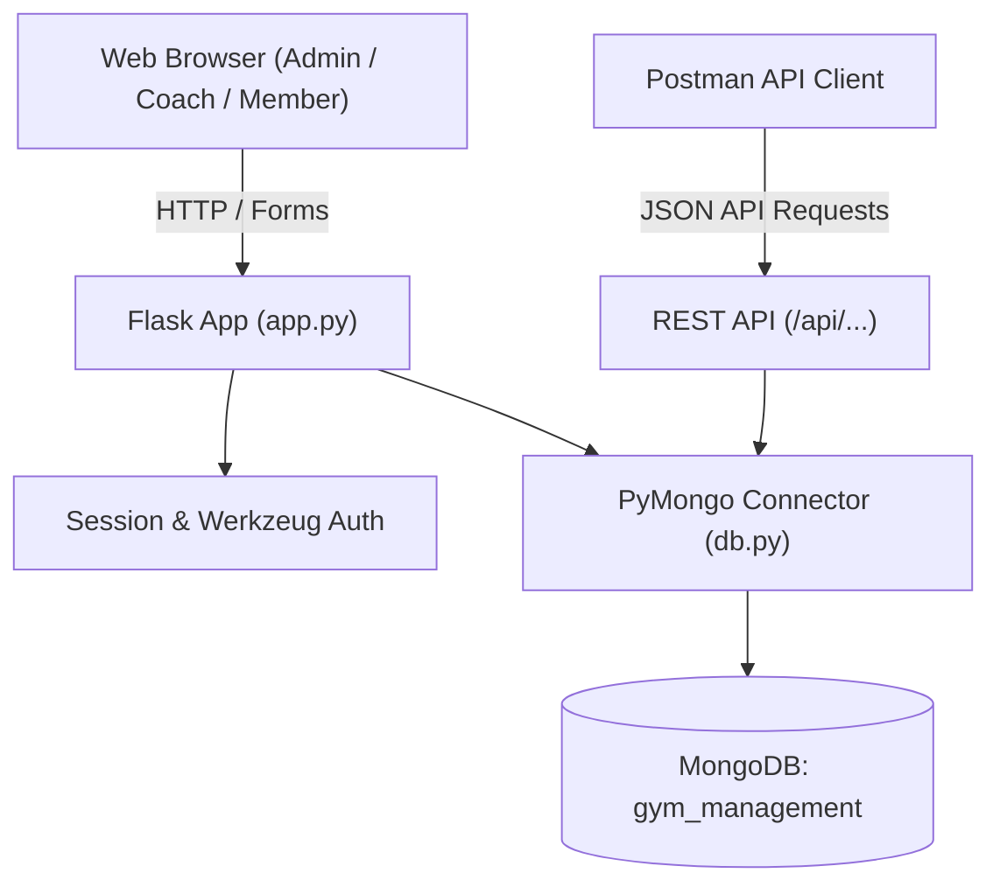

# FitPulse — Gym Management System (Full-Stack Web Application)

A complete, production-grade, full-stack Gym Management System built with **Python Flask**, **MongoDB** (via **PyMongo**), and a modern **Bootstrap 5** frontend. Designed for college capstone demonstrations, technical viva presentations, and real-world fitness facility management.

[](https://www.python.org/)
[](https://flask.palletsprojects.com/)
[](https://www.mongodb.com/)
[](https://getbootstrap.com/)
[]()

> **GitHub Repository:** `https://github.com/Pratham161106/FitPulse-Gym-Management-System`

---

## 1. System Architecture

FitPulse utilizes a clean 3-tier architecture:
- **Presentation Layer:** Jinja2 server-rendered templates, HTML5, Vanilla CSS3, JavaScript, and Bootstrap 5 with responsive dark-sidebar layouts.
- **Application Layer:** Python Flask REST routing, role-based session authentication (`@role_required`), and Werkzeug salted password hashing.
- **Data Layer:** MongoDB document database (compatible with Local MongoDB Community Server or MongoDB Atlas Cloud).
- **API Testing:** JSON REST endpoints (`/api/*`) with importable Postman collection.



---

## 2. Key Modules & User Roles

### 🛡️ Admin
- **Dashboard:** Live analytics for active members, valid plans, expired plans, trainer headcount, gross revenue, and daily attendance check-ins.
- **Member Management:** Add, view, edit, search (by name/email/phone), activate, or deactivate members.
- **Coach / Trainer Management:** Maintain coach directory, specializations, experience, and shifts.
- **Membership Packages:** Create and manage flexible plans with automatic duration computation.
- **Plan Assignment & Renewals:** Assign plans to athletes with automated expiry calculations and transaction generation.
- **Payments Ledger:** Record and audit manual/simulated payment transactions.
- **Attendance Registry:** Log daily member check-ins and check-outs with date filters.
- **Workout Builder:** Create routines with customizable exercises, sets, reps, and form instructions.
- **Reports:** Revenue distribution across packages, 7-day attendance trends, and retention rates.

### 🏋️ Coach / Trainer
- **Coach Portal:** Monitor assigned athletes and training schedules.
- **Workout Routine Builder:** Design specific workouts and assign them to members.
- **Trainee Health & Fitness Profiles:** Review athlete health notes and progress.

### 👤 Member
- **Member Portal:** View active subscription, countdown timer to expiry, and attendance stats.
- **Workout Schedule:** Access assigned exercises, recommended sets, repetitions, and coach notes.
- **Billing History:** Review payment receipts and transaction references.
- **Profile:** Manage contact information, emergency contacts, and personal health notes.

---

## 3. MongoDB Collections Structure

The database `gym_management` uses 9 structured collections:

| Collection | Description | Key Fields |
| :--- | :--- | :--- |
| `users` | Shared authentication records | `_id`, `name`, `email` *(Unique)*, `phone`, `password_hash`, `role`, `status` |
| `members` | Member-specific fitness profiles | `_id`, `user_id`, `gender`, `dob`, `emergency_contact`, `health_notes` |
| `trainers` | Fitness instructor profiles | `_id`, `user_id`, `specialization`, `experience_years`, `availability`, `bio` |
| `membership_plans` | Gym packages & rates | `_id`, `plan_name`, `duration_days`, `price`, `description`, `status` |
| `member_memberships` | Active & historical subscriptions | `_id`, `member_id`, `plan_id`, `start_date`, `end_date`, `status`, `assigned_by` |
| `payments` | Audit receipts (recorded/simulated) | `_id`, `member_id`, `amount`, `payment_date`, `payment_method`, `reference_no` |
| `attendance` | Daily check-in logs | `_id`, `member_id`, `date`, `check_in_time`, `check_out_time`, `status` |
| `workout_plans` | Reusable workout templates | `_id`, `name`, `difficulty`, `exercises`: `[{name, sets, reps, instructions}]` |
| `member_workouts` | Member workout assignments | `_id`, `member_id`, `workout_plan_id`, `trainer_id`, `assigned_date`, `notes` |

---

## 4. Local Installation & Setup Guide

### Prerequisites
- Python 3.10 or higher
- MongoDB Community Server running locally on port `27017` **OR** a MongoDB Atlas connection URI
- VS Code & Git

### Step 1: Clone the Repository
```bash
git clone https://github.com/PranavBhujbal350/Gym_management_system.git
cd gym-management-system
```

### Step 2: Create and Activate Virtual Environment
**On Windows (PowerShell):**
```powershell
python -m venv venv
.\venv\Scripts\Activate.ps1
```

**On macOS / Linux:**
```bash
python3 -m venv venv
source venv/bin/activate
```

### Step 3: Install Dependencies
```bash
pip install -r requirements.txt
```

### Step 4: Configure Environment Variables
Copy `.env.example` to `.env`:
```powershell
Copy-Item .env.example .env
```
Ensure your `MONGO_URI` is correctly specified:
- **Local MongoDB:** `MONGO_URI=mongodb://localhost:27017/gym_management`
- **MongoDB Atlas Cloud:** `MONGO_URI=mongodb+srv://<username>:<password>@cluster0.mongodb.net/gym_management?retryWrites=true&w=majority`

### Step 5: Initialize the Database & Seed Accounts
Run the database setup script:
```powershell
python init_db.py
```
*This automatically sets up collection indexes and seeds default Admin, Coach, Member accounts, membership plans, and sample workout routines.*

### Step 6: Start the Application
```powershell
python app.py
```
Open your browser and navigate to: **`http://127.0.0.1:5000`**

---

## 5. Default Demonstration Accounts

The login page includes **1-click quick autofill buttons** for live examiner demonstrations:

| Role | Email Address | Password | Permissions |
| :--- | :--- | :--- | :--- |
| **Admin** | `admin@gym.com` | `admin123` | Full dashboard, members, trainers, plans, billing, attendance, reports |
| **Trainer** | `trainer@gym.com` | `trainer123` | Trainees roster, workout routine builder, assign workouts |
| **Member** | `member@gym.com` | `member123` | Active plan countdown, workout view, attendance log, payment receipts |

---

## 6. Postman API Testing

An importable Postman collection is located at:
`postman/Gym_Management_API.postman_collection.json`

### Import into Postman:
1. Open Postman.
2. Click **Import** in the top-left corner.
3. Select `postman/Gym_Management_API.postman_collection.json`.
4. Ensure the Flask server is running at `http://127.0.0.1:5000`.

### Included REST Endpoints:
- `POST /api/auth/register` — Register a new member account
- `POST /api/auth/login` — Authenticate and receive session cookie
- `POST /api/auth/logout` — End user session
- `GET /api/members` — Fetch member directory with `?status=` and `?search=` filters
- `GET /api/members/:id` — Retrieve member details with active membership
- `POST /api/members` — Administrative member creation
- `PUT /api/members/:id` — Update member attributes
- `GET /api/memberships` — Retrieve membership records
- `GET /api/attendance` — Retrieve check-in entries with `?date=` filter
- `POST /api/attendance` — Log an attendance check-in entry

---

## 7. Viva & Presentation Guide

### Frequently Asked Viva Questions

**Q1: Why did you choose MongoDB instead of a traditional relational database (MySQL)?**
> *Answer:* Gym management data includes nested exercise lists inside workout plans, flexible member health notes, and scalable athlete profiles. MongoDB's document model represents exercise arrays naturally within documents without needing multiple join tables, while indexing on `email` and `user_id` ensures speed and data integrity.

**Q2: How is password security handled?**
> *Answer:* Plaintext passwords are never saved. We use `werkzeug.security.generate_password_hash` with PBKDF2/SHA256 salting to hash passwords during registration. During login, `check_password_hash` verifies the hash without exposing the password.

**Q3: How are roles and unauthorized access prevented?**
> *Answer:* We implemented Python decorator functions `@login_required` and `@role_required(*roles)`. If a member attempts to access an admin URL (`/admin/dashboard`), Flask intercepts the request and responds with an HTTP `403 Forbidden` error page. Hiding frontend buttons is never relied on for security.

**Q4: How are payments handled?**
> *Answer:* To ensure safe college demonstration without external banking dependencies or test card failures, the application implements a simulated/manual payment recording workflow. It generates unique transaction reference IDs (`PAY-XXXX`) and maintains an immutable audit ledger.

---

## 8. GitHub Version Control Workflow

To push this codebase to your own GitHub account:

```powershell
# 1. Initialize git
git init

# 2. Add all files (respects .gitignore)
git add .

# 3. Create initial commit
git commit -m "Initial commit: Complete Gym Management System"

# 4. Set branch to main
git branch -M main

# 5. Link to your remote GitHub repository
git remote add origin https://github.com/PranavBhujbal350/Gym_management_system.git

# 6. Push code to GitHub
git push -u origin main
```

---

## 9. License

This project is created for educational and college capstone demonstration purposes under the MIT License.
